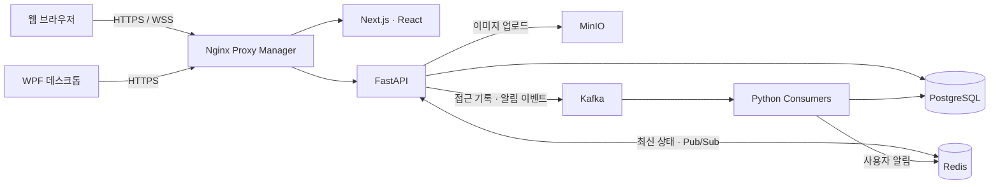
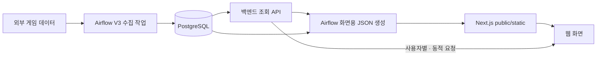
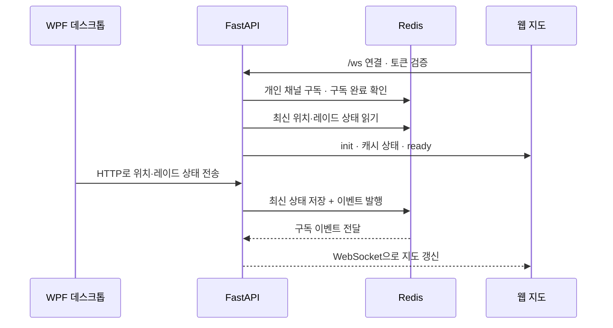

# 타르코프 도서관 · Backend

**갱신일: 2026.10.20**

[타르코프 도서관](https://eftlibrary.com)의 API 서버입니다. **FastAPI**를 사용해 게임 정보와 사용자 데이터를 조회·저장하고, 실시간 지도·파티·채팅·알림을 웹과 데스크톱 프로그램에 전달합니다.

게임 데이터를 주기적으로 수집하는 일은 Airflow가 담당합니다. 백엔드는 수집된 PostgreSQL 데이터를 서비스에 맞게 조회하고, 사용자 요청과 실시간 연결을 처리합니다.

## 전체 서비스에서 맡은 역할


Cloudflare는 **DNS Only**로 사용합니다. 도메인 해석 이후 HTTPS·WSS 트래픽은 원본 서버의 Nginx Proxy Manager로 직접 연결됩니다. 웹 화면은 Next.js·React가 제공하며, 동적 데이터와 WebSocket 연결은 이 백엔드에서 처리합니다.



DNS 조회는 위 요청 흐름에서 생략했습니다. 접근 기록·알림 consumer는 별도 Kafka 프로젝트에서 실행합니다.

## 제공하는 기능

| 영역          | 하는 일                                                          | 주요 코드                                                                                         |
| ------------- | ---------------------------------------------------------------- | ------------------------------------------------------------------------------------------------- |
| 게임 정보     | 아이템·퀘스트·보스·지도·은신처·상인 관련 데이터 조회             | `api/item`, `api/quest`, `api/boss`, `api/map`, `api/hideout`                                     |
| 가격          | PVP·PVE·시즌 가격과 지난 시즌 조회                               | `api/price`                                                                                       |
| 사용자 데이터 | 사용자 정보·진행도·로드맵 등 저장 및 조회                        | `api/user`, `api/progress`, `api/roadmap`                                                         |
| 커뮤니티      | 게시글·댓글·반응·이미지 업로드                                   | `api/community`, `api/comment`                                                                    |
| 실시간 지도   | 지도 층·지점·경로 등 지도 데이터 조회                            | `api/live_map`                                                                                    |
| 파티          | 방·멤버·마커 관리, 위치·핑·접속 상태 공유                        | `api/live_map/party_v3`                                                                           |
| 채팅          | 메시지·접속자·초대·차단·신고·제재 관리                           | `api/live_map/chat_v3`                                                                            |
| 내 위치 찾기  | 데스크톱 위치·레이드 상태 수신, 버전·맵 별칭·경로 보고·분석 이력 | `api/where_am_i`                                                                                  |
| 콘텐츠·운영   | 홈·검색·스토리·배틀패스·프레스티지·배포 공지 등                  | `api/home`, `api/search`, `api/story`, `api/battle_pass`, `api/prestige`, `api/deployment_notice` |

등록된 API 목록은 [api/router.py](api/router.py)와 실행 중인 서버의 `/docs`에서 확인합니다. 일부 내부 경로는 Swagger에 표시하지 않습니다.

## Airflow와 데이터가 연결되는 방식



Airflow는 게임 정보를 갱신하고, 백엔드 API 또는 DB에서 읽은 데이터로 화면용 JSON을 생성합니다. 출력 경로는 Airflow 환경의 `/opt/airflow/next-public`입니다. 이 파일을 웹에서 제공하려면 프런트엔드의 public 경로와 연결되어 있어야 합니다. 이미지·업로드 저장소인 MinIO와는 역할이 다릅니다.

시즌 가격은 수집·검증·DB 커밋 이후 정적 JSON을 생성합니다. 현재 시즌 외의 가격은 백엔드에서 시즌을 선택해 조회할 수 있습니다.

## WebSocket과 Redis

위치·알림, 파티, 채팅은 각각 별도 소켓을 사용합니다. 아래 `{API_PREFIX}`는 환경 변수 값이며, 예를 들어 `/api`로 설정합니다.

| 연결           | 경로                                                | 인증·초기 상태                                                   |
| -------------- | --------------------------------------------------- | ---------------------------------------------------------------- |
| 개인 위치·알림 | `/ws?token=…`                                       | Google 토큰 검증 후 연결, 대기 알림과 최신 위치·레이드 상태 복원 |
| 파티           | `{API_PREFIX}/live-map/v3/party/rooms/{room_id}/ws` | 첫 auth 메시지와 방 접근 권한 확인, Redis 구독 후 snapshot 전달  |
| 채팅           | `{API_PREFIX}/live-map/v3/chat/ws`                  | 첫 auth 또는 guest 메시지 처리, Redis 구독 후 snapshot 전달      |

루트의 `/ws`에는 `API_PREFIX`가 붙지 않습니다. 외부에서는 WSS를 사용하며 Reverse Proxy가 WebSocket Upgrade를 전달하도록 설정합니다.



최신 위치는 Redis에 TTL 60초로 보관합니다. 위치 소켓은 탭별로 독립 구독을 가지며, Redis 재연결 후 최신 상태를 다시 읽습니다. 이 과정은 전체 이벤트 이력 재생이 아닙니다. 브라우저 소켓 자체가 끊어지면 클라이언트가 재접속하고 인증·초기 동기화를 다시 수행합니다.

파티·채팅의 영속 데이터는 PostgreSQL에, 접속 상태와 실시간 위치·핑 등 일시 상태는 Redis에 저장합니다. 사용자 알림은 Kafka consumer가 DB 저장 후 Redis에 발행하며, 지도 실시간 이벤트 경로와 구분합니다.

## DB 구조와 V3 개발 규칙

현재 스키마의 기준은 **[platform_db.sql](platform_db.sql)**입니다. 아이템·퀘스트·지도 등의 관계를 정규화한 구조를 사용합니다.

- 신규 DB 접근은 [database.py](database.py)의 `V3Database`를 사용합니다.
- 신규 모델·함수·서비스·쿼리 이름에는 `V3` 또는 `_v3`를 붙입니다.
- 기존 코드·경로는 유지하고 신규 V3 구현을 별도로 추가합니다. 기존 경로가 내부적으로 V3 구현을 호출하는 경우도 있으므로 URL만으로 구현 버전을 판단하지 않습니다.
- `DB.sql`과 `DataBaseConnector`는 레거시 영역입니다. `Vector.sql`은 과거 RAG 관련 정의이며 현재 플랫폼 스키마의 기준이 아닙니다.

기존 DB 변경용 SQL은 [sql/migrations](sql/migrations)에 있습니다. 배포 전 기능별 문서에서 필요한 SQL과 적용 순서를 확인합니다. `platform_db.sql`은 현재 구조를 정의하는 파일이며, 전체 파일을 기존 DB에 재실행하는 방식으로 마이그레이션하지 않습니다.

상세 개발 규칙은 [AGENTS.md](AGENTS.md)를 따릅니다.

## 디렉토리 구조

```text
.
├── main.py                 # FastAPI 앱, 미들웨어, 루트 WebSocket·상태 확인
├── database.py             # V3Database와 레거시 DB 연결
├── api/
│   ├── router.py           # 기능별 라우터 등록
│   ├── live_map/
│   │   ├── party_v3/       # 파티 REST·WebSocket·상태 저장
│   │   └── chat_v3/        # 채팅 REST·WebSocket·운영 기능
│   └── where_am_i/         # 데스크톱 연동·메타데이터·분석
├── util/                   # Kafka, 미들웨어, 위치 소켓·인증, 로그
├── docs/                   # API 계약·프런트엔드 연동·운영 문서
├── sql/migrations/         # 기존 DB 변경용 SQL
├── tests/                  # V3 회귀·통합 테스트
├── platform_db.sql         # 현재 스키마
├── DB.sql                  # 레거시 스키마 참고
└── restart.sh              # 기존 운영 실행·중지 스크립트
```

`api/chat`에는 과거 외부 Agent 스트림 연동 코드가 남아 있습니다. 현재 실시간 채팅은 `api/live_map/chat_v3`이며, 두 기능은 별개입니다.

> 지워야 하는데, 시기를 못잡고 있습니다...

## 실행 환경과 설정

주요 패키지는 FastAPI·Uvicorn, SQLAlchemy·psycopg2-binary, Redis, confluent-kafka, python-dotenv, requests·httpx입니다. 커뮤니티 이미지 처리에는 MinIO·Pillow, 식별자·문자열 처리에는 nanoid·python-slugify 등을 사용합니다.

현재 저장소에는 의존성 버전을 고정한 requirements 또는 lock 파일이 없습니다. 아래는 개발 환경 구성 예시이며 운영 환경과 동일한 버전을 보장하지 않습니다.

```bash
python3 -m venv .venv
source .venv/bin/activate
python -m pip install 'fastapi[all]' sqlalchemy psycopg2-binary python-dotenv \
  redis confluent-kafka requests httpx pytz tzdata minio pillow nanoid python-slugify setuptools
```

프로젝트 루트의 `.env`에 다음 설정을 준비합니다. DB 스키마와 연결할 PostgreSQL·Redis·Kafka·MinIO도 별도로 준비해야 합니다. `.env`의 실제 접속 정보와 인증키는 저장소에 커밋하지 않습니다.

| 설정                                                     | 용도                                                                          |
| -------------------------------------------------------- | ----------------------------------------------------------------------------- |
| `API_PREFIX`                                             | 기능 API 접두사. 예: `/api`                                                   |
| `DB_HOST`, `DB_PORT`, `DB_USER`, `DB_PASSWORD`           | PostgreSQL 접속 정보                                                          |
| `V3_DB_NAME`                                             | 정규화된 V3 데이터베이스 이름                                                 |
| `DB_NAME`                                                | 남아 있는 레거시 경로용 데이터베이스 이름                                     |
| `GOOGLE_TOKEN_INFO_URL`                                  | Google access token 검증 URL                                                  |
| `REDIS_HOST`                                             | 위치·알림 연결에 사용. `host:port` 형식으로 설정하면 코드가 `redis://`를 붙임 |
| `REDIS_URL`                                              | 파티·채팅 Redis URL. 미설정 시 해당 기능은 `REDIS_HOST`를 사용                |
| `BOOTSTRAP_SERVER`                                       | Kafka broker 주소                                                             |
| `LOG_TOPIC`, `NOTIFICATION_TOPIC`                        | 접근 기록·사용자 알림 topic                                                   |
| `MINIO_ENDPOINT`, `MINIO_ACCESS_KEY`, `MINIO_SECRET_KEY` | 이미지 업로드 저장소 연결                                                     |
| `API_RATE_LIMIT_PER_MINUTE`                              | 요청 제한 기준. 기본값 `1000`, 현재 프로세스 메모리에서 집계                  |

파티·채팅 정책에는 `PARTY_CLEANUP_ENABLED`와 `V3_PARTY_INVITE_*` 등의 추가 설정이 있습니다. 사용 범위와 정책은 아래 기능별 문서를 참고합니다. `REDIS_URL`만으로는 위치·알림의 `REDIS_HOST` 설정을 대체하지 못합니다.

설정 후 개발 서버를 실행합니다.

```bash
uvicorn main:app --host 127.0.0.1 --port 8000 --reload
```

- API 문서: `http://127.0.0.1:8000/docs`
- OpenAPI: `http://127.0.0.1:8000/openapi.json`
- 상태 확인: `http://127.0.0.1:8000/health`

`/health`는 서버 응답 여부만 확인하며 DB·Redis·Kafka 상태를 검사하지 않습니다. 로그인은 프런트엔드의 Google OAuth·NextAuth와 연동하고 백엔드에서 Google 토큰을 검증합니다. 비밀번호 로그인은 사용하지 않습니다.

[restart.sh](restart.sh)는 `venv/bin/activate`, 기본 포트 `9022`, Uvicorn worker 9개를 사용하는 기존 운영 스크립트입니다. 위 개발 예시의 `.venv`와 경로가 다르므로 실행 환경에 맞는지 확인합니다.|

## 개발 기록

구현 과정과 시행착오는 [백엔드 개발 기록](https://velog.io/@poeynus/series/%EB%B0%B1%EC%97%94%EB%93%9C-%EA%B0%9C%EB%B0%9C)에 정리하고 있습니다.

많이 놀러 와주세용!
